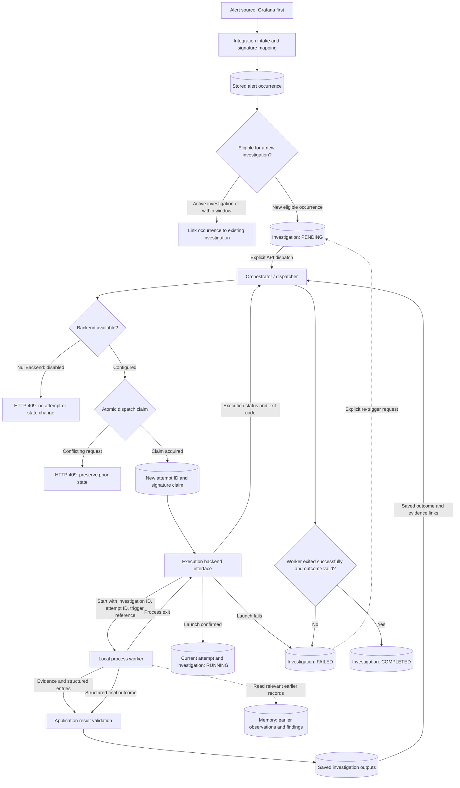
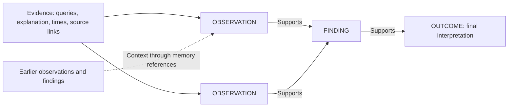
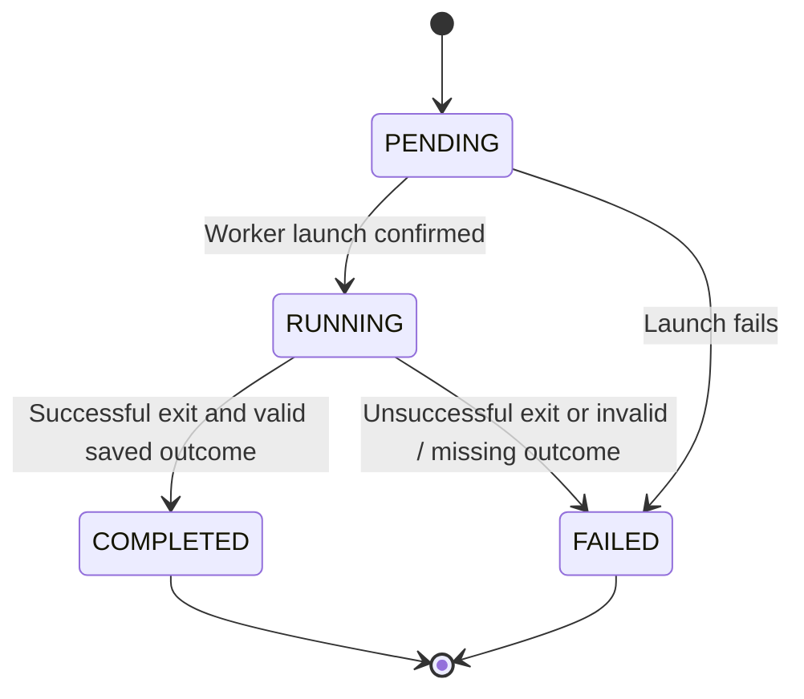

# ADR 0001: Investigation records and worker dispatch

Date: 2026-10-13

Last updated: 2026-10-15

Status: Accepted. The local wrapper was implemented on 2026-10-14. Agent design and verification are covered by ADR 0002; reconciliation remains deferred.

## Context

At the start of this decision, Hawkdive received alert notifications and stored occurrences and pending jobs.
Grafana is the first integration. The investigation wrapper must support other alert sources.
Investigation worker execution was not implemented at that point.

An occurrence is one continuous firing period.
Each integration maps its notifications to an alert signature and an occurrence identity.
For Grafana, the current occurrence identity includes the source, organization, fingerprint, and start time.
A repeated firing notification reports that the same occurrence is still active, with the same start time.
It is not a new firing period. It updates stored evidence without creating another job.
A new start time creates another occurrence, even when the alert fingerprint stays the same.
Storing another occurrence does not necessarily create another investigation.

An investigation explains an occurrence using evidence.
Alert resolution does not establish the cause or prove that a defect is fixed.
Earlier investigations can provide context for a recurring alert.

The worker uses a LangGraph agent with reasoning enabled, detailed in [ADR 0002](0002-langgraph-agent-and-shell-sandbox.md).
Its implementation is outside this decision.
The application needs a wrapper that can dispatch workers without depending on LangGraph or a specific execution platform.

## Decision

Keep investigation records separate from alert occurrences and execution attempts.
Use a configurable time window to control investigation creation for the same alert signature.
An investigation retains its original trigger and can reference additional related occurrences.
An investigation can have multiple sequential attempts, but at most one active attempt.
Each dispatch creates a new attempt ID and preserves earlier attempt records.

The orchestrator owns investigation state and execution identity.
The agent produces evidence, observations, findings, and an outcome.
The application validates and stores those outputs.

### Investigation eligibility

An alert signature identifies the same alert across firing periods.
It includes the integration and source scope, plus the integration's stable alert identifier.
For Grafana, the current equivalent is `source + grafana_org_id + fingerprint`.
The shared wrapper uses the mapped signature, not Grafana-specific fields.
Signature mapping for later integrations will be defined with those integrations.

Store every new occurrence. Apply investigation eligibility separately.
Repeated notifications for an existing occurrence do not create another investigation.
For a new occurrence with the same signature:

- If an investigation is pending or has an active attempt, link the occurrence to it without scheduling another worker.
- If the investigation window has not expired, link the occurrence to the existing investigation without creating another one.
- Otherwise, the new occurrence can trigger another investigation.

Measure the window from investigation creation using application time.
Repeated notifications and linked occurrences do not extend the window.
Window expiry alone does not trigger work or duplicate an existing occurrence's investigation.
An active attempt still prevents another worker after the window expires.
The global default is one hour, configured through `HAWKDIVE_INVESTIGATION_WINDOW_SECONDS`.
Per-signature overrides are deferred. Configuration changes apply only to new investigations.

For example, an alert repeatedly fires and resolves within the configured window.
Each firing period remains in history, but the periods reference one investigation.
Linking a later occurrence does not reopen a completed investigation or rewrite its outcome.

Investigation creation and the signature eligibility check must be atomic.
Dispatch also requires an atomic claim; a time window alone does not prevent concurrent workers.

### Interactions

The local transport uses one JSON request on standard input and JSON output records on standard output.
The application validates and saves each output record as it arrives.
The worker must emit its complete outcome before exiting successfully.
The application saves and validates the outcome before recording completion.
The orchestrator can be the application backend that implements dispatch, validation, and state management.
The execution backend interface is an internal boundary and does not require another service.
The dispatcher always receives a backend. An unconfigured application supplies `NullBackend`.
That backend rejects dispatch before an attempt is created and never reports successful execution.
The process backend launches workers and reports execution status.
The agent produces the interpretation of findings; the application validates the output contract.

The local process backend comes first.
Containers, Argo workflows, and Kubernetes Jobs can later implement the same execution interface.
These backends are extension points, not dependencies to add now.

### Investigation outputs

Arrows show the supporting evidence flow. Saved records contain references in the reverse direction:
`OUTCOME -> FINDING(s) -> OBSERVATION(s) -> evidence`.

| Record | Responsibility and contents |
| --- | --- |
| Investigation | Application ID, original trigger reference, signature, related occurrence references, state, and investigation window. No separate question field. |
| Attempt | Unique attempt ID, investigation reference, state, lifecycle timestamps, backend execution reference, exit code, and execution error when available. |
| Evidence | Query, concise text explanation in `reasoning`, time range, and source reference. |
| OBSERVATION | Agent-written observation or hypothesis update, with evidence references when applicable. |
| FINDING | Agent-written supported finding, with one or more supporting observation IDs. |
| OUTCOME | Structured final interpretation, uncertainty, suggested next steps, and one or more supporting finding IDs. |
| Memory reference | Reference to an earlier investigation, observation, or finding retrieved for context. |

Observation entries preserve intermediate hypotheses and their assessment as evidence changes.
They are explicit, concise investigation updates; private model reasoning is not a storage contract.
Findings and the outcome use structured output.
The field schemas are defined in `hawkdive/investigations.py`.
The local protocol is documented in [the wrapper guide](../local/worker-wrapper.md).
Evidence, observations, findings, and outcomes also identify the attempt that produced them.
The orchestrator assigns that execution ownership when storing output from the worker stream.
Workers do not include investigation or attempt IDs in their output records.
Input identities, output identities, and supporting output references use UUIDs.
Output content uses concrete models, with `OutputKind` as a `StrEnum`.
Stored investigation, attempt, and output records are read through Pydantic schemas with UUID fields.
This validates persisted data and publishes concrete API response schemas.
Required text and supporting-reference rules are validated in application code, without JSON Schema length constraints.
Earlier attempt outputs remain saved; they cannot replace the current attempt's outcome.

Every finding must reference at least one saved observation from its investigation.
Every outcome must reference at least one saved finding from its investigation.
The application rejects missing references and references belonging to another investigation or attempt.
Earlier attempt material can be referenced as memory; the current attempt must establish its own evidence chain.
Memory references remain separate from the current evidence chain.
Earlier findings do not automatically prove the cause of the current occurrence.

An inconclusive outcome is valid.
Its supporting finding explains why the available observations cannot establish a cause.

### Attempt lifecycle

`PENDING` means the current attempt is waiting to launch. A task record alone does not establish execution.
`RUNNING` means launch is confirmed and execution has not finished.
`FAILED` and `COMPLETED` are terminal states for an attempt.
Successful execution can produce an inconclusive outcome.

The investigation starts as `PENDING`, even before its first attempt exists.
It reflects the current attempt's state once that attempt is created.
Without an explicit re-trigger request, a finished investigation stays `FAILED` or `COMPLETED`.
Re-triggering a failed investigation creates a new attempt and returns the investigation to `PENDING`.
The failed attempt remains terminal and its history stays intact.
Re-trigger behavior for completed investigations is not defined here.
An authenticated `POST /investigations/{id}/retry` creates the next attempt for a failed investigation.
Automatic retry policy remains outside this ADR's scope.

### Dispatch and concurrency

Use an atomic database claim before launching a worker.
Create the next attempt and reserve the alert signature in that claim.
Keep the reservation during launch, even before the state becomes `RUNNING`.
This prevents another dispatcher from launching overlapping work.

Allow at most one active attempt and worker per investigation.
Also allow at most one active investigation worker for a mapped alert signature.
The signature deliberately excludes the occurrence start time.

A new occurrence during an active investigation becomes a related occurrence, not another queued investigation.
If an explicit dispatch request is blocked by an active signature claim, return HTTP 409 without starting another attempt.
The investigation stays in its prior state. The caller can submit the request again later.
Different alert signatures can run concurrently.
Release the claim after confirmed execution termination and terminal state recording.
A result validation error alone must not release a claim while the worker is still active.
Releasing a claim does not start another attempt or set another investigation to `RUNNING`.
The dispatcher must claim eligible work, launch its worker, and confirm launch first.

Every output stream is bound to the investigation and attempt by the orchestrator.
The application accepts records only while that execution context belongs to the active attempt.
Reject late output from a finished attempt, including after a later attempt starts.
Attempt identity permits separate histories for sequential attempts, never overlapping workers.

## Reasons

- Separate occurrences from investigations so alert history survives changes to execution behavior.
- Map source-specific identity at intake so Grafana remains one integration within a general investigation system.
- Use a configurable investigation window so a flaky alert does not create an investigation for every firing period.
- Preserve sequential attempts so an investigation can be re-triggered without losing failed execution history.
- Keep lifecycle state application-managed so the agent cannot declare execution success on its own.
- Require evidence links so readers can trace an outcome to its supporting observations.
- Preserve intermediate updates so readers can review how findings developed.
- Separate memory from evidence so historical similarity does not become proof of a current cause.
- Use a backend interface so execution platforms can change without changing investigation records.
- Start with a process because it provides an execution boundary and observable exit codes.
- Claim work atomically so concurrent dispatchers cannot start workers for the same alert.
- Require a valid saved outcome because exit code zero alone does not guarantee a usable investigation result.

## Scope and consequences

Implement the records, result validation, dispatcher, and local process backend before adding an agent.
Use a minimal test worker to exercise execution and output contracts.
Test launch failure, successful completion, invalid results, sequential attempts, and prevention of overlapping dispatch.
Also test repeated occurrences within the window, window expiry, and atomic investigation eligibility.

Startup reconciliation is deferred.
After a dispatcher crash, unresolved claims need manual review before further dispatch for that alert.
An uncertain worker status must not authorize another launch.

Cancellation, automatic retries, memory retrieval, and distributed execution backends are deferred.
Resolution closes an occurrence but keeps pending investigations eligible.
The wrapper does not start processes automatically when a webhook arrives.
This ADR does not introduce a `CANCELLED` investigation state or active worker cancellation.
Graceful application shutdown stops owned processes and marks interrupted attempts as failed.

## Implementation order

1. Define record schemas and structured output validation.
2. Define the execution backend contract: start execution and read its status.
3. Define the configurable investigation window and implement atomic eligibility checks.
4. Implement the atomic dispatch claim and single-active-attempt rule.
5. Implement a local process backend and minimal test worker.
6. Validate lifecycle transitions, evidence links, investigation windows, and concurrency behavior.
7. Keep pending investigations eligible after resolution. Use explicit API dispatch for the local wrapper.
8. Add the LangGraph agent and reconciliation in separate decisions.

## Implementation notes

Revision `0002` replaces the legacy jobs table with investigations, occurrence links, attempts, and outputs.
It preserves occurrence and notification history. Legacy jobs are grouped by mapped alert signature.
Legacy records lack receipt timestamps, so their initial one-hour window starts at migration time.
GET /jobs remains a compatibility view; new clients should use /investigations.
Worker commands are configured by the application. API requests cannot supply arbitrary executable commands.

The ORM name `AlertOccurrence` replaces the unclear name `Issue`.
The existing `issues` table and `/issues` routes remain for compatibility.
`InvestigationOccurrence` links each firing period to its investigation, so a window can cover several periods without losing alert history.
Alert signatures control eligibility across occurrences; notification digests only identify exact payload duplicates.

All non-test functions have parameter and return annotations, excluding implicit `self` and `cls`.
Migration templates also generate annotated functions. This does not imply a complete static type-checker audit.

## Verification

The wrapper verification suite passed 53 tests before the agent tests were added.
Tests cover migration preservation, investigation windows, atomic eligibility, and overlapping dispatch from two application instances.
Process tests cover intermediate output, valid completion, failures, invalid evidence links, explicit retries, and rejection of late results.

The null-backend integration test uses FastAPI's test client and a real temporary SQLite database.
It posts an authenticated alert, confirms a pending investigation, and requests dispatch.
Dispatch returns HTTP 409; the investigation remains pending with no attempts or outputs.
A separate test confirms that directly starting `NullBackend` reports disabled execution.
These checks do not use a live HTTP server or Grafana to exercise the null backend.
