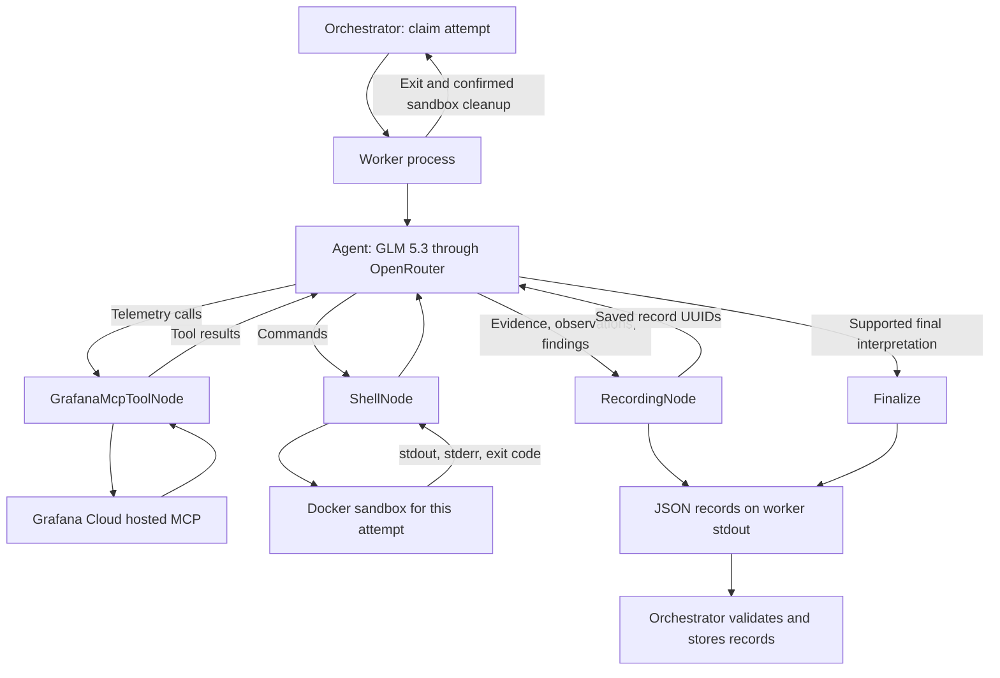

# ADR 0002: LangGraph agent, Grafana Cloud MCP, and shell sandbox

Date: 2026-10-14

Last updated: 2026-10-15

Status: Accepted. Local graph and process integration tests pass. Live provider and Docker verification remain pending.

## Context

[ADR 0001](0001-investigation-worker-wrapper.md) defines investigations, attempts, structured records, and process dispatch.
The worker now needs to gather information and produce those records.
The first model is GLM 5.3 through OpenRouter, with reasoning enabled.
Grafana is the first alert integration. Its hosted Cloud MCP service provides telemetry access.
The agent also needs a filesystem for scratchpads, calculations, and source analysis.

## Decisions

Use LangGraph with separate `GrafanaMcpToolNode` and `ShellNode` execution paths.
The agent chooses which tool to call next and receives its result before making another model request.
When one response requests several tools, execute all its calls in order before returning to the model.

`RecordingNode` emits evidence, observations, and findings while the investigation progresses.
`Finalize` emits the outcome and ends the graph.
Record UUIDs are generated by the worker runtime, not requested from the model.
Findings must reference saved observations. Outcomes must reference saved findings.
The worker checks these references before emission; the orchestrator validates them again before storage.
Agent messages and private model reasoning are not written as investigation records.

### Model

Use OpenRouter model `z-ai/glm-5.3` with `max` reasoning effort by default.
The configured effort can be `low`, `high`, or `max`.
Use the dedicated `langchain-openrouter` integration.
Model requests retain their returned reasoning metadata within the conversation for later tool turns.
The application emits only explicit structured investigation records.

Defaults limit an attempt to 20 model calls and 300 seconds of investigation runtime.
Each model request has a 60-second timeout and a 32,768-token output ceiling.
Automatic model-request retries are disabled in this initial implementation.

### Grafana Cloud MCP

Connect to `https://mcp.grafana.com/mcp` through Streamable HTTP.
Pass the configured stack through `X-Grafana-URL` and authenticate with an existing OAuth access token.
Use LangChain's `MCPAdapter` to discover and adapt the server's tools.
Expose an explicit read-tool allowlist for datasource discovery, dashboards, annotations, and Prometheus queries.
Do not expose write tools or raw SQL tools to the model.
The allowlist is defined in `hawkdive/agent/grafana.py`.

No additional MCP server is hosted by Hawkdive or added to Docker Compose.
OAuth sign-in, token storage, and refresh remain future application responsibilities.
The first implementation accepts an existing access token from application configuration.
Expired or rejected credentials fail the attempt; the worker does not open a browser or refresh credentials.

### Shell sandbox

Use a separate Docker container and named workspace volume for each attempt UUID.
Run shell commands through our own asynchronous subprocess runner, without `BashProcess` or a community shell-tool dependency.
The worker controls Docker. The model supplies only the command executed inside the sandbox.

The image provides Bash, Python, Git, and certificate authorities.
Run as user 1000 with a read-only root filesystem and writable `/workspace` and `/tmp`.
Drop Linux capabilities and enable no-new-privileges.
Limit the container to one CPU, 512 MiB memory, and 128 processes.
Do not mount the host filesystem or Docker socket.
Outbound networking remains available for public source checkouts.
Private repository authentication is not implemented.

Keep workspace files between shell calls within one attempt.
Each call starts a new shell; shell variables and working-directory changes do not persist between calls.
Use `/workspace` as the initial directory for every command.
Record the repository and exact commit in observations when source code supports a finding.

Commands default to a 30-second timeout.
Drain stdout and stderr while retaining at most 12,000 bytes from each stream.
Report truncation and exit codes to the agent.
On command timeout, remove the container to stop the actual command, not just its Docker client.

Remove the container when the worker exits, including normal completion and failure.
The supervising process backend also confirms removal before recording a terminal state and releasing the attempt claim.
If removal cannot be confirmed, do not release the claim. Manual review remains necessary until reconciliation is implemented.
Retain the workspace volume for inspection after the container is removed.
Artifact selection, export, and retention automation are deferred.

### Credentials and execution configuration

Keep execution configuration separate from `WorkerInput` and investigation records.
The application supplies it through the worker environment, not command-line arguments.
Pass a limited set of OS environment variables plus the explicitly configured model and MCP settings.
Do not inherit all application environment variables into workers or Docker command clients.
Do not pass model or MCP credentials into the sandbox.

Secret fields are excluded from public configuration serialization and representations.
Known credentials are redacted from model-visible tool results and emitted investigation records.
Provider exceptions are reported by type without copying request details into worker output.
Disable LangSmith tracing in the worker environment.

## Reasons

- Separate tool nodes give shell execution and telemetry access distinct responsibilities and future policies.
- A persistent workspace supports calculations and source analysis across several agent turns.
- One sandbox per attempt prevents scratchpad state from crossing investigation attempts.
- Grafana's hosted MCP service avoids another server deployment for the initial Cloud integration.
- Existing OAuth access tokens let us implement the agent without building onboarding at the same time.
- Explicit record tools preserve the evidence chain already defined in ADR 0001.
- Process supervision owns cleanup because a terminated worker cannot reliably run its own cleanup code.

## Verification and limits

Diagnostics use logging on stderr. Worker records use JSON lines on stdout.
Ruff enforces sorted module-level imports and rejects imports inside functions.
It rejects print statements outside tests. Tests and test helpers may use print.

Local tests use an MCP test server and a scripted model to exercise the real LangGraph graph.
The complete suite passed 67 tests; one opt-in Docker test was skipped during this verification.
An HTTP integration test dispatches that graph in a separate process and checks persisted evidence, observations, findings, and outcome.
Tests also cover output-reference validation, credential boundaries, model-call limits, command timeouts, and bounded command output.

These tests do not establish successful authentication to Grafana Cloud or successful inference through OpenRouter.
The real sandbox test is opt-in and requires a running Docker engine and a built sandbox image.
Live verification was unavailable during implementation because Docker had no running engine and provider credentials were not configured.

Startup reconciliation, automatic dispatch, OAuth refresh, memory retrieval, private repository access, and sandbox artifact export remain deferred.
The agent is opt-in. Without agent configuration or a custom worker command, the existing null backend remains active.

## References

- [LangChain MCP adapter](https://docs.langchain.com/oss/python/langchain/mcp)
- [Grafana Cloud MCP](https://grafana.com/docs/grafana-cloud/ai-tools/mcp-servers/cloud-mcp/)
- [GLM 5.3 on OpenRouter](https://openrouter.ai/z-ai/glm-5.3)
- [ChatOpenRouter integration](https://docs.langchain.com/oss/python/integrations/chat/openrouter)
- [Docker container execution](https://docs.docker.com/engine/containers/run/)
